# BlackHellHeim — Propuesta de modelo entidad-relación (ER)

> **Propósito:** servir como modelo lógico de referencia para el MVP de BlackHellHeim, una tienda ecommerce de ropa con variantes de productos, carrito, checkout, pagos, dropshipping y seguimiento de envíos.
>
> **Tecnología objetivo:** SQL Server y backend ASP.NET Core. El modelo es una propuesta lógica, no un script de migración listo para ejecutar. Los tipos y restricciones finales deben definirse al implementar el esquema.

## 1. Decisiones principales

1. **Separar producto, variante y selección del cliente.** `productos` representa el artículo del catálogo; `variantes_producto` representa una combinación vendible de producto, color y talla; `carrito_items` representa una variante agregada al carrito. Ya no se necesita una entidad `ProductosSeleccionados`.
2. **Conservar una fotografía de la compra.** `items_compra` almacena el nombre, SKU, color, talla, precio e impuesto aplicados cuando se realizó el pedido. Los cambios posteriores del catálogo no deben modificar el historial.
3. **Separar compra, pago y envío.** Una compra puede tener varios intentos de pago, reembolsos y envíos. El estado del pedido no sustituye al estado del pago ni al del envío.
4. **Conservar la dirección de envío histórica.** `direcciones_compra` contiene una copia de la dirección confirmada al comprar; no depende de que el usuario mantenga intacta su libreta de direcciones.
5. **Preparar el catálogo para dropshipping.** `variantes_proveedor` vincula las variantes propias con identificadores de productos o variantes de proveedores externos. `proveedor_compras` registra el pedido enviado al proveedor.
6. **Usar claves foráneas y restricciones reales.** Las líneas del diagrama indican las relaciones esperadas, pero la implementación SQL debe añadir claves únicas, validaciones, índices y reglas de eliminación.
7. **Mantener el diseño enfocado en el MVP.** Reseñas, fotos de reseñas, favoritos e historial de estados aparecen en el modelo, aunque pueden implementarse después del flujo de compra básico.

## 2. Diagrama ER propuesto

El diagrama está agrupado visualmente por dominios, pero representa un único modelo integrado. Se usan nombres sin acentos para facilitar su uso en código y SQL.

```mermaid
erDiagram
    USUARIOS {
        bigint id PK
        varchar nombre
        varchar apellido
        varchar correo UK
        varchar password_hash
        bit activo
        datetime fecha_creacion
    }

    ROLES {
        int id PK
        varchar codigo UK
        varchar nombre
    }

    USUARIOS_ROLES {
        bigint usuario_id PK, FK
        int rol_id PK, FK
    }

    DIRECCIONES_USUARIO {
        bigint id PK
        bigint usuario_id FK
        varchar alias
        varchar destinatario
        varchar telefono
        varchar calle
        varchar numero_exterior
        varchar numero_interior
        varchar colonia
        varchar ciudad
        varchar estado_region
        varchar codigo_postal
        char pais_codigo
        varchar referencias
    }

    CATEGORIAS {
        int id PK
        int categoria_padre_id FK
        varchar nombre UK
        varchar slug UK
        bit activa
    }

    PRODUCTOS {
        bigint id PK
        int categoria_id FK
        varchar titulo
        varchar slug UK
        varchar descripcion
        varchar publico_objetivo
        varchar estado
        datetime fecha_creacion
        datetime fecha_actualizacion
    }

    COLORES {
        int id PK
        varchar nombre UK
        varchar codigo_hex
    }

    TALLAS {
        int id PK
        varchar nombre UK
        int orden
    }

    VARIANTES_PRODUCTO {
        bigint id PK
        bigint producto_id FK
        int color_id FK
        int talla_id FK
        varchar sku UK
        decimal precio_venta
        char moneda
        varchar estado
        datetime fecha_creacion
    }

    FOTOS_PRODUCTO {
        bigint id PK
        bigint producto_id FK
        bigint variante_producto_id FK
        varchar url
        varchar texto_alternativo
        int orden
    }

    ETIQUETAS {
        int id PK
        varchar nombre UK
        varchar slug UK
    }

    PRODUCTOS_ETIQUETAS {
        bigint producto_id PK, FK
        int etiqueta_id PK, FK
    }

    PROVEEDORES {
        int id PK
        varchar nombre UK
        varchar tipo
        varchar sitio_web
        bit activo
    }

    VARIANTES_PROVEEDOR {
        bigint id PK
        bigint variante_producto_id FK
        int proveedor_id FK
        varchar producto_externo_id
        varchar variante_externa_id
        varchar sku_proveedor
        decimal costo_proveedor
        char moneda_costo
        varchar disponibilidad_externa
        datetime ultima_sincronizacion
    }

    CARRITOS {
        bigint id PK
        bigint usuario_id FK
        varchar estado
        datetime fecha_creacion
        datetime fecha_actualizacion
    }

    CARRITO_ITEMS {
        bigint id PK
        bigint carrito_id FK
        bigint variante_producto_id FK
        int cantidad
        datetime fecha_agregado
    }

    ESTADOS_COMPRA {
        int id PK
        varchar codigo UK
        varchar nombre
    }

    COMPRAS {
        bigint id PK
        varchar numero_pedido UK
        bigint usuario_id FK
        int estado_compra_id FK
        decimal subtotal
        decimal descuento_total
        decimal impuesto_total
        decimal envio_total
        decimal total
        char moneda
        datetime fecha_creacion
        datetime fecha_confirmacion
    }

    DIRECCIONES_COMPRA {
        bigint compra_id PK, FK
        bigint direccion_usuario_id FK
        varchar destinatario_snapshot
        varchar telefono_snapshot
        varchar calle_snapshot
        varchar numero_exterior_snapshot
        varchar numero_interior_snapshot
        varchar colonia_snapshot
        varchar ciudad_snapshot
        varchar estado_region_snapshot
        varchar codigo_postal_snapshot
        char pais_codigo_snapshot
        varchar referencias_snapshot
    }

    ITEMS_COMPRA {
        bigint id PK
        bigint compra_id FK
        bigint variante_producto_id FK
        varchar nombre_producto_snapshot
        varchar sku_snapshot
        varchar color_snapshot
        varchar talla_snapshot
        int cantidad
        decimal precio_unitario
        decimal tasa_impuesto
        decimal importe_impuesto
        decimal subtotal
        decimal total_linea
    }

    HISTORIAL_ESTADOS_COMPRA {
        bigint id PK
        bigint compra_id FK
        int estado_compra_id FK
        bigint cambiado_por_usuario_id FK
        datetime fecha_cambio
        varchar comentario
    }

    ESTADOS_PAGO {
        int id PK
        varchar codigo UK
        varchar nombre
    }

    PAGOS {
        bigint id PK
        bigint compra_id FK
        int estado_pago_id FK
        varchar proveedor_pago
        varchar referencia_externa
        decimal importe
        char moneda
        datetime fecha_creacion
        datetime fecha_confirmacion
    }

    REEMBOLSOS {
        bigint id PK
        bigint pago_id FK
        varchar referencia_externa
        decimal importe
        varchar estado
        datetime fecha_solicitud
        datetime fecha_procesado
    }

    PROVEEDOR_COMPRAS {
        bigint id PK
        bigint compra_id FK
        int proveedor_id FK
        varchar referencia_externa
        varchar estado_proveedor
        datetime fecha_envio_proveedor
        datetime fecha_confirmacion_proveedor
    }

    ITEMS_PROVEEDOR_COMPRA {
        bigint id PK
        bigint proveedor_compra_id FK
        bigint item_compra_id FK
        bigint variante_proveedor_id FK
        int cantidad
    }

    PAQUETERIAS {
        int id PK
        varchar nombre UK
        varchar sitio_web
        bit activa
    }

    ESTADOS_ENVIO {
        int id PK
        varchar codigo UK
        varchar nombre
    }

    ENVIOS {
        bigint id PK
        bigint compra_id FK
        int paqueteria_id FK
        int estado_envio_id FK
        varchar codigo_seguimiento
        datetime fecha_creacion
        datetime fecha_despacho
        datetime fecha_entrega
    }

    ITEMS_ENVIO {
        bigint id PK
        bigint envio_id FK
        bigint item_compra_id FK
        int cantidad
    }

    EVENTOS_SEGUIMIENTO {
        bigint id PK
        bigint envio_id FK
        int estado_envio_id FK
        varchar estado_externo
        varchar descripcion
        varchar ubicacion
        datetime fecha_evento
    }

    FAVORITOS {
        bigint usuario_id PK, FK
        bigint producto_id PK, FK
        datetime fecha_agregado
    }

    RESENAS {
        bigint id PK
        bigint usuario_id FK
        bigint producto_id FK
        bigint item_compra_id FK
        int calificacion
        varchar comentario
        varchar estado
        datetime fecha_creacion
    }

    FOTOS_RESENAS {
        bigint id PK
        bigint resena_id FK
        varchar url
        datetime fecha_creacion
    }

    USUARIOS ||--o{ USUARIOS_ROLES : tiene
    ROLES ||--o{ USUARIOS_ROLES : asignado
    USUARIOS ||--o{ DIRECCIONES_USUARIO : guarda

    CATEGORIAS o|--o{ CATEGORIAS : agrupa
    CATEGORIAS ||--o{ PRODUCTOS : clasifica
    PRODUCTOS ||--|{ VARIANTES_PRODUCTO : ofrece
    COLORES ||--o{ VARIANTES_PRODUCTO : define
    TALLAS ||--o{ VARIANTES_PRODUCTO : define
    PRODUCTOS ||--o{ FOTOS_PRODUCTO : muestra
    VARIANTES_PRODUCTO o|--o{ FOTOS_PRODUCTO : puede_ilustrar
    PRODUCTOS ||--o{ PRODUCTOS_ETIQUETAS : etiqueta
    ETIQUETAS ||--o{ PRODUCTOS_ETIQUETAS : clasifica
    VARIANTES_PRODUCTO ||--o{ VARIANTES_PROVEEDOR : se_mapea_a
    PROVEEDORES ||--o{ VARIANTES_PROVEEDOR : suministra

    USUARIOS ||--o{ CARRITOS : posee
    CARRITOS ||--o{ CARRITO_ITEMS : contiene
    VARIANTES_PRODUCTO ||--o{ CARRITO_ITEMS : seleccionada

    USUARIOS ||--o{ COMPRAS : realiza
    ESTADOS_COMPRA ||--o{ COMPRAS : clasifica
    COMPRAS ||--|| DIRECCIONES_COMPRA : conserva
    COMPRAS ||--|{ ITEMS_COMPRA : incluye
    VARIANTES_PRODUCTO o|--o{ ITEMS_COMPRA : referencia
    COMPRAS ||--o{ HISTORIAL_ESTADOS_COMPRA : registra
    ESTADOS_COMPRA ||--o{ HISTORIAL_ESTADOS_COMPRA : identifica
    USUARIOS o|--o{ HISTORIAL_ESTADOS_COMPRA : modifica

    COMPRAS ||--o{ PAGOS : recibe_intentos
    ESTADOS_PAGO ||--o{ PAGOS : clasifica
    PAGOS ||--o{ REEMBOLSOS : puede_generar

    COMPRAS ||--o{ PROVEEDOR_COMPRAS : se_envia_a
    PROVEEDORES ||--o{ PROVEEDOR_COMPRAS : recibe
    PROVEEDOR_COMPRAS ||--o{ ITEMS_PROVEEDOR_COMPRA : contiene
    ITEMS_COMPRA ||--o{ ITEMS_PROVEEDOR_COMPRA : abastece
    VARIANTES_PROVEEDOR ||--o{ ITEMS_PROVEEDOR_COMPRA : identifica

    COMPRAS ||--o{ ENVIOS : puede_dividirse
    PAQUETERIAS o|--o{ ENVIOS : transporta
    ESTADOS_ENVIO ||--o{ ENVIOS : clasifica
    ENVIOS ||--o{ ITEMS_ENVIO : contiene
    ITEMS_COMPRA ||--o{ ITEMS_ENVIO : distribuye
    ENVIOS ||--o{ EVENTOS_SEGUIMIENTO : registra
    ESTADOS_ENVIO ||--o{ EVENTOS_SEGUIMIENTO : identifica

    USUARIOS ||--o{ FAVORITOS : guarda
    PRODUCTOS ||--o{ FAVORITOS : aparece_en
    USUARIOS ||--o{ RESENAS : escribe
    PRODUCTOS ||--o{ RESENAS : recibe
    ITEMS_COMPRA o|--o| RESENAS : puede_verificar
    RESENAS ||--o{ FOTOS_RESENAS : adjunta
```

## 3. Cómo leer las áreas principales

### 3.1 Catálogo y variantes

- `productos` representa una ficha comercial, por ejemplo, una playera de BlackHellHeim.
- `variantes_producto` representa cada combinación vendible de talla y color. Ejemplo: `PLAYERA-NEGRA-M`.
- La combinación `(producto_id, color_id, talla_id)` debe ser única si no se permiten dos variantes idénticas del mismo producto.
- `sku` debe ser único. El SKU interno no debe depender únicamente del código que entrega un proveedor externo.
- `fotos_producto` permite fotografías generales del producto y, si se indica `variante_producto_id`, fotografías específicas de una variante.
- `categorias.categoria_padre_id` permite categorías y subcategorías sin necesitar una tabla `tipo_productos` adicional. Si el negocio realmente necesita un concepto diferente de tipo de producto, se puede agregar más adelante con una regla clara.

### 3.2 Proveedor de dropshipping

- `proveedores` registra proveedores externos.
- `variantes_proveedor` relaciona una variante interna con su identificador/SKU externo y permite registrar disponibilidad y costo sincronizados.
- `proveedor_compras` conserva el identificador y estado del pedido enviado al proveedor.
- `items_proveedor_compra` relaciona las líneas del pedido del cliente con las líneas remitidas al proveedor.
- No se modela inventario propio en este diseño porque el supuesto es dropshipping. La disponibilidad externa debe comprobarse y actualizarse según lo permita la API del proveedor.
- No se debe asumir que un pedido al proveedor fue aceptado solo porque la tienda registró una compra; deben persistirse los resultados de las llamadas y reintentos de integración.

### 3.3 Carrito y compra

- `carritos` es la cabecera; `carrito_items` son sus líneas.
- `carritos.estado` puede usar valores definidos, por ejemplo `ACTIVO`, `CONVERTIDO`, `ABANDONADO` o `CERRADO`.
- `compras` es la cabecera de la operación del cliente y `items_compra` guarda las líneas compradas.
- `items_compra` conserva los atributos comerciales como snapshot. Aunque `variante_producto_id` apunte a una variante actual, los valores históricos deben poder leerse sin depender de ella.
- `direcciones_compra` es una copia inmutable de la dirección confirmada en checkout. `direccion_usuario_id` sirve solo como referencia opcional a la dirección guardada originalmente.
- El checkout debe volver a validar precio y disponibilidad. El precio que se mostró al añadir al carrito no constituye una garantía de precio final.

### 3.4 Pagos

- Una compra puede tener varios registros en `pagos` para cubrir intentos fallidos y posteriores reintentos.
- `proveedor_pago` identifica la pasarela o procesador. `referencia_externa` guarda el identificador de transacción generado por dicho proveedor, no los datos de la tarjeta.
- `reembolsos` permite registrar devoluciones totales o parciales vinculadas al pago correspondiente.
- Los cambios de estado de un pago deben proceder de una respuesta verificada de la pasarela o de una comprobación confiable del backend. La creación del pedido no equivale a un pago confirmado.

### 3.5 Envíos y rastreo

- Una compra puede tener varios `envios` si el pedido se divide en paquetes.
- `items_envio` indica qué cantidades de cada línea comprada van en cada paquete.
- `eventos_seguimiento` almacena cada actualización, en vez de guardar únicamente la última ubicación.
- El código de seguimiento puede ser nulo hasta que la paquetería lo proporcione.

### 3.6 Reseñas y favoritos

- `favoritos` une usuarios y productos; debe impedirse que el mismo producto se guarde dos veces en favoritos de un usuario.
- `resenas` se relaciona con el producto y el autor. `item_compra_id` es opcional para admitir reseñas no verificadas; si BlackHellHeim decide aceptar solo reseñas verificadas, debe hacerse obligatorio y validarse que la línea comprada pertenece al mismo usuario y producto.
- `fotos_resenas` permite adjuntar varias fotos a una reseña.

## 4. Restricciones e índices recomendados

Las siguientes reglas deben implementarse en SQL Server además de las claves primarias y foráneas representadas en el diagrama.

| Tabla | Regla recomendada |
|---|---|
| `usuarios` | Correo normalizado único; no guardar contraseñas en texto plano. |
| `usuarios_roles` | PK compuesta `(usuario_id, rol_id)`. |
| `categorias` | `slug` único; validar que una categoría no sea su propia antecesora. |
| `variantes_producto` | `sku` único; `UNIQUE(producto_id, color_id, talla_id)` si esa combinación identifica una sola variante. |
| `variantes_producto` | `precio_venta >= 0`; `moneda` en formato ISO 4217, por ejemplo `MXN`. |
| `variantes_proveedor` | Identificadores externos únicos según el proveedor; `UNIQUE(proveedor_id, variante_externa_id)` cuando el proveedor garantice esa unicidad. |
| `carrito_items` | `cantidad > 0`; `UNIQUE(carrito_id, variante_producto_id)` para consolidar una variante en una línea. |
| `carritos` | Definir y asegurar la regla de un solo carrito activo por usuario, si ese es el comportamiento deseado. Puede requerir un índice filtrado. |
| `compras` | `numero_pedido` único; importes no negativos; verificar consistencia entre subtotal, descuento, impuestos, envío y total. |
| `items_compra` | `cantidad > 0`; importes no negativos; `precio_unitario`, impuestos y total guardados como valores históricos. |
| `pagos` | Importe mayor que cero; evitar procesar dos veces la misma referencia externa con una restricción de idempotencia adecuada. |
| `reembolsos` | Importe mayor que cero y suma de reembolsos no superior al importe reembolsable del pago, según las reglas de negocio. |
| `items_envio` | `cantidad > 0`; la suma enviada de una línea no debe superar la cantidad comprada. Esto puede necesitar validación transaccional en el backend. |
| `resenas` | `calificacion BETWEEN 1 AND 5`; definir si se permite una reseña por usuario y producto o por línea de compra. |
| `favoritos` | PK compuesta `(usuario_id, producto_id)`. |

### Tipos de datos para SQL Server

- Usar `decimal(12,2)` (o una precisión justificada por el negocio) para importes; evitar cálculos monetarios con `float`.
- Usar `varchar(5)` o `char(5)` para códigos postales mexicanos, no números, para conservar ceros iniciales.
- Guardar teléfonos como texto, porque pueden incluir prefijos internacionales y no se usan para hacer operaciones matemáticas.
- Usar UTC para marcas de tiempo (`datetime2` recomendado) y convertir a hora local en la interfaz.
- Aplicar `NOT NULL` a los campos que son obligatorios en cada etapa y permitir nulos solo cuando el dato todavía no exista o sea genuinamente opcional.
- Definir explícitamente las reglas `ON DELETE`. Para productos con historial de ventas, normalmente es mejor desactivar el producto que borrarlo físicamente. Los pedidos deben conservar sus snapshots aunque la variante deje de estar publicada.

## 5. Estados sugeridos

Los códigos son ilustrativos; deben definirse como catálogo o como valores controlados con `CHECK`, sin mezclar estados de distintos procesos.

- **Carrito:** `ACTIVO`, `CONVERTIDO`, `ABANDONADO`, `CERRADO`.
- **Compra:** `PENDIENTE_PAGO`, `PAGADA`, `EN_PREPARACION`, `ENVIADA`, `ENTREGADA`, `CANCELADA`, `REEMBOLSADA`.
- **Pago:** `PENDIENTE`, `AUTORIZADO`, `PAGADO`, `RECHAZADO`, `CANCELADO`, `REEMBOLSO_PARCIAL`, `REEMBOLSADO`.
- **Envío:** `PENDIENTE`, `PREPARANDO`, `DESPACHADO`, `EN_TRANSITO`, `ENTREGADO`, `INCIDENCIA`, `DEVUELTO`.
- **Pedido al proveedor:** `PENDIENTE_ENVIO`, `ENVIADO`, `ACEPTADO`, `RECHAZADO`, `EN_PRODUCCION`, `COMPLETADO`, `CANCELADO`.

Los estados deben representar hechos diferentes. Por ejemplo, un pago rechazado no tiene por qué significar que el pedido esté cancelado inmediatamente; el usuario podría intentar pagar otra vez.

## 6. Notas para ASP.NET Core y el MVP

- El diagrama usa `usuarios`, `roles` y `usuarios_roles` como nombres conceptuales. Si se utiliza **ASP.NET Core Identity**, es preferible adoptar sus entidades/tablas (`AspNetUsers`, `AspNetRoles`, `AspNetUserRoles`, etc.) o extenderlas, en vez de implementar una segunda tabla de usuarios y autenticación paralela.
- El backend debe recalcular o verificar el precio, los impuestos, descuentos, envío y disponibilidad durante el checkout. No debe confiar en importes enviados por el frontend.
- Las notificaciones del proveedor de pagos y las confirmaciones de envío deben validarse y procesarse de forma idempotente para no duplicar pagos, pedidos al proveedor o eventos.
- El diagrama no incluye cupones, promociones, facturación CFDI, devoluciones de productos, carrito de invitado ni almacén físico. Se pueden añadir cuando exista un requerimiento concreto.
- Si el MVP solo permite un proveedor y un paquete por compra, algunas tablas pueden parecer más complejas de lo necesario. Se mantienen porque permiten dividir pedidos y rastrear estados sin cambiar las entidades principales si el negocio crece.

## 7. Orden sugerido de implementación

1. Catálogo: `categorias`, `productos`, `colores`, `tallas`, `variantes_producto`, `fotos_producto` y mapeo con `proveedores`.
2. Usuarios y direcciones: adoptar Identity o implementar la integración de autenticación definida por el proyecto.
3. Carrito: `carritos` y `carrito_items`, con validación de variante, precio y disponibilidad.
4. Checkout: `compras`, `items_compra`, `direcciones_compra` e `historial_estados_compra`.
5. Pagos: `pagos` y `reembolsos`, incluyendo confirmación del proveedor y manejo idempotente.
6. Dropshipping y envíos: `proveedor_compras`, sus líneas, `envios`, `items_envio` y `eventos_seguimiento`.
7. Complementos: etiquetas, favoritos, reseñas y fotos de reseñas.

## 8. Qué reemplaza del modelo anterior

| Modelo anterior | Propuesta |
|---|---|
| `ProductosSeleccionados` | Se elimina como entidad central; `variantes_producto` representa las combinaciones vendibles. |
| `Carrito` con una selección por fila | `carritos` como cabecera y `carrito_items` como líneas. |
| `ProductosComprados` apuntando a `ProductoSeleccionadoId` | `items_compra` apunta opcionalmente a `variante_producto_id` y conserva snapshots históricos. |
| `ColoresEnProductos` y `TallasEnRopa` | La disponibilidad de combinaciones se determina desde `variantes_producto`; no mantener dos fuentes contradictorias. |
| `SeguimientoPaquete` y `UltimasUbicacionesPaquetes` | `envios`, `items_envio` y `eventos_seguimiento` para representar envíos y múltiples eventos de rastreo. |
| Estado de compra como única señal | Estados separados para compra, pago, envío y pedido al proveedor. |
| Dirección actual del usuario como única dirección | `direcciones_usuario` para la libreta y `direcciones_compra` para la copia histórica del pedido. |

---

**Recomendación:** validar primero el catálogo de variantes y el flujo de checkout con ejemplos concretos (playera con varias tallas/colores, pago rechazado, reintento de pago, pedido dividido en dos paquetes y cambio posterior de dirección). Si el esquema puede representar esos escenarios sin duplicar o perder información, estará mejor preparado para convertirse en entidades EF Core y migraciones SQL Server.
